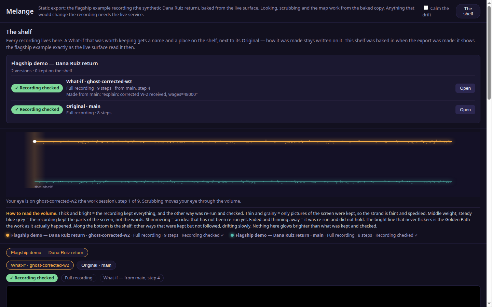
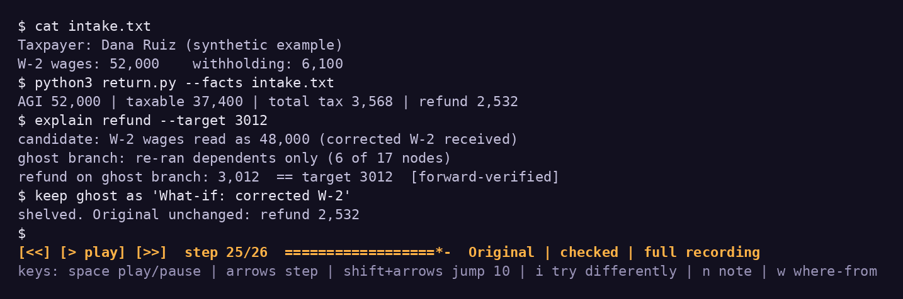
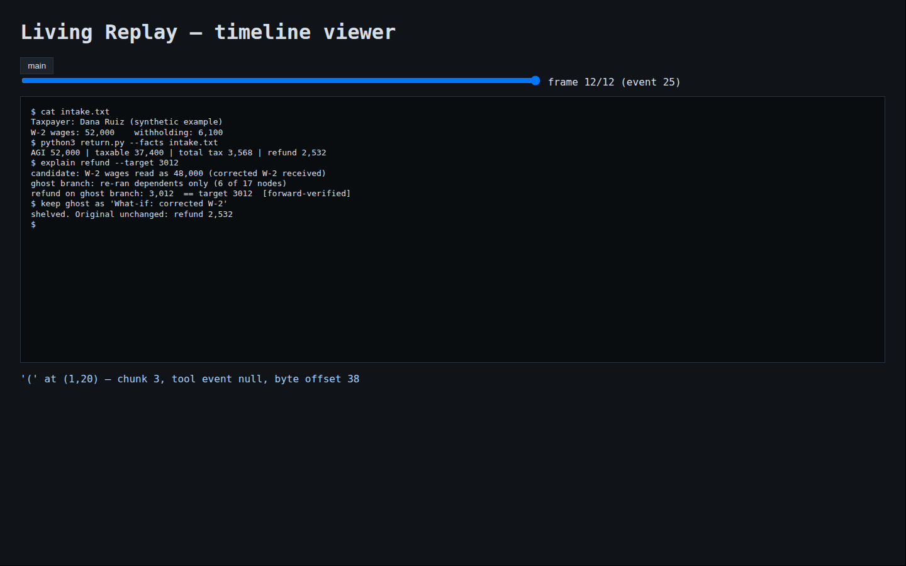

# Melange — canonical tree

> **This is the canonical Melange repository** (unified 2026-10-17, M1 prep).
> It merges the three divergent trees — the onyx `lr-repo` (UX program), the
> SHATNER `living-replay` tree, and this VM's Build-3-era tree + `lr-live`
> working files — module by module. See `UNIFICATION.md` for the full
> per-module provenance table, the merge decisions, and the flagged
> NOT-MERGED variants. The repository went public on 2026-10-19; see
> `ROADMAP.md` for what is open and `CONTRIBUTING.md` for how to help.

## See it



*The shelf in the static surface export: the synthetic flagship return, its
verified What-if branch, and the volume map. Looking and scrubbing work from
this baked copy; anything that changes a recording needs the live service.*



*The terminal viewer on a synthetic session: an explain run whose ghost
branch forward-verified, shelved beside the untouched Original.*



*Any timeline exports to one self-contained HTML viewer. Clicking a
character shows exactly what caused it: the chunk, the tool event, and the
byte offset.*

## Contributing

Contributions are welcome. Start with [CONTRIBUTING.md](CONTRIBUTING.md)
for setup and the rules (short version: nothing merges without
forward-execution verification), and [ROADMAP.md](ROADMAP.md) for the open
work, including pieces sized for a first contribution. Licensed under MIT;
see [LICENSE](LICENSE).

## Tests — the canonical count

```
PYTHONPATH=src python3 -m unittest discover -s tests
```

**215 tests: 199 passed, 0 failed, 16 skipped** — measured 2026-10-19 on
WSL Ubuntu, Python 3.12.3, with pyte, Z3, cryptography, python-xlib, Tk,
tmux and Xvfb. The skips require external workbook/store fixtures or the
Firecracker sandbox (`LR_SANDBOX_DIR`). The GUI gate ran and passed.
Historical gate measurements below retain their dates and environments.
See [the review report](docs/code-review-2026-10-19.md) for before/after
results and [M9 desktop capture](docs/m9-desktop-capture.md) for the new
recorder and its real-browser verification.

**Melange** (formerly Living Replay) records computation the way a video codec records a scene — keyframes are snapshots, deltas are logged actions, playback is resumption — except the recording stays executable: rewind to the layer where a decision was made, insert an adjustment, and the session runs forward again on a fork. The pinned timeline is the **Golden Path**.

Project write-up: https://melange.hatch.gg

## Credits

- **Suzu** — the two-doors architecture: trace transcription in (any software's traces become codec frames at labeled fidelity) and render out (any branch, including a counterfactual, exports to plain video). Raised in the Nous Research Discord, October 16, 2026, and adopted into the design the same day.

Harness-first, Linux-first reference for recording a controlled agent terminal as an append-only ledger. The PTY tap is the substrate of record; tmux control mode is deliberately not used.

Builds 1–3 below are the engine. The UX program (2026-10-16) added the operating layer on top of the same store: `bridge.py` (the single UI-facing API — it enforces declared fidelity per branch, since the store does not; notes are real store events), `ingest.py` (Door 2: foreign traces and screen frames ingested at declared fidelity — native / structure / screen-only — with per-branch capability gates), and `tui.py` (terminal viewer). Design language: `docs/melange-ux-design.md`. Surface builders live in `tools/` (`build_surface.py`, `build_surface2.py`).

## Open the player

Run `./start-melange.ps1` on Windows with WSL, or `service/run.sh` on Linux,
then open http://localhost:8798. The default recording is a generated synthetic
example. Play or slide through it, choose **Go to calculation**, click **Wages**,
and try 48000. The player opens the recalculated What-if and lets you compare
the unchanged Original. Notes are saved in the recording. See
[`service/README.md`](service/README.md) for your own recordings and setup.

## Architecture

`PtyCapture` owns a pseudo-terminal, redacts bytes before they enter storage, appends `terminal_chunk` events with monotonic clock/byte offsets, and writes content-addressed payloads. `TimelineStore` is SQLite plus SHA-256 objects and per-branch hash chains. `Grid` is a deterministic ANSI terminal grid with per-cell `{offset, chunk_id, tool_event}` provenance. `reconstruct` decodes events/keyframes into a frame, and `provenance` returns an attribution or an explicit unattributed result.

Event kinds: `terminal_chunk`, `grid_keyframe`, `tool_call`, `model_call`, `workspace_snapshot`, `context_note`, `fork`, and typed `edit` (`clamp`, `explain`, `pin`). `forking.py` archives/restores a synthetic workspace checkpoint. `runner.py` is the fork-runner: a fork restarts from a checkpoint with the workspace restored, the agent context truncated to the checkpoint, and an optional pinned note, then runs the task live on the new branch (the parent branch is never written). `edits.py` exposes the Build-1 solver seam: clamp overlays a frame value, pins report named violations, and `explain` tries supplied candidate causes and accepts only a forward-verified fork. Build 2 lands the remaining rungs (`lenses.py`, `smt.py`, `taint.py`), dependents-only recomputation (`incremental.py`), the viewer export (`export_viewer.py`), and the Firecracker sandbox (`sandbox.py`, `sandbox/`) — see the Build 2 section below.

The grid implements the control surface real TUIs use — scroll regions and scrolling, insert/delete lines and chars, the alternate screen, saved cursor, tabs, deferred wrap, wide chars — and holds back partial escape sequences and partial UTF-8 chars across chunk boundaries instead of dropping them. Alternate-screen set/reset follows the reference emulator's (pyte's) buffer no-op semantics so the gate corpus compares like with like; xterm's buffer-restore behaviour differs and is a non-claim below.

## Gate results (measured 2026-10-15, `tests/test_gates.py`)

| Gate | Requirement | Measured |
| --- | --- | --- |
| G1 replay fidelity | ≥99.5% cells at 100 sampled times vs ground truth | **100.0000%** over 220 sampled frames (33 chunk boundaries + 187 sub-chunk slices) across 9 hostile scenarios (scroll, curses box edit, alt screen, scroll regions, erase/attrs, tabs, delete lines/chars, dashboard redraw), ground truth = pyte fed the same stored bytes |
| G2 pixel-to-cause | ≥95% of shell/file content resolves to chunk + tool call | **98.11%** of 53 content cells; the single unattributed cell is a deliberate control, reported as unattributed |
| G3 fork correctness | Fork + injected note finishes the task on a new branch, original unchanged | Pass: fork with note `amount=50` produced `total=100` on the new branch; parent events and screen byte-identical before/after; fork context provably truncated at the checkpoint; workspace snapshot restored |
| G4 redaction | Zero seeded secrets in the persisted timeline | **0 of 6** seeds present at rest, including a secret split across two PTY writes (the capture withholds a 64-byte tail so split secrets are whole before redaction runs) |
| G5 replay-by-record | Recorded session replays with zero live model calls | Pass: full transcript reproduced from the record; live model calls during replay = 0 |
| G6 typed edits | Clamp defined + downstream recompute; explain forward-verified or unresolved-with-counterexamples; pins reported by name | Pass: clamp 42→48 recomputed tax 4.80; explain accepted 1 of 2 candidates into a real ghost branch (1 counterexample kept) and reported unresolved when no candidate verified; a fork breaking pin `total=48` reported the violation by name |

## Build 2 (2026-10-15)

Solvers and the sandbox, per `BUILD2-BRIEF.md`:

- `lenses.py` — solver rung 1: bidirectional get/put lenses over source documents, law-checked (GetPut/PutGet); a clamp on a lens-sourced value compiles to a put() that writes only the extracted region.
- `smt.py` — solver rung 2: pipeline graphs whose nodes carry a numeric formula and a Z3 mirror; goal seek minimises changed inputs, then total change, and every solution is forward-verified (Z3 is the optional `solver` extra).
- `taint.py` — solver rung 4, lazy: nothing is taint-tracked at record time; a provenance query replays only the producing slice with byte-level taint and returns exact input byte ranges.
- `incremental.py` — dependents-only recomputation with early cutoff over the pipeline graph.
- `export_viewer.py` — a timeline with all its branches exports to one self-contained HTML scrubber with per-cell provenance.
- `sandbox/` + `sandbox.py` — architecture B: a Firecracker microVM is the boundary. The guest runs the session inside the VM with Build 1 capture onto a data drive; the host snapshots it at a checkpoint, resumes the original (it finishes untouched), and forks the snapshot into fresh microVMs that receive a context note over vsock and finish differently. Host-side tooling reads the timelines back off the drives and replays them — the desktop is a viewer. Two lessons are baked into the driver: a halted guest does not exit Firecracker on minimal kernels (completion is signalled on serial and the host tears the VM down), and a restored vsock backend binds the host path stored in the snapshot (a fork is reached through the original's uds path).

### Build 2 gate results (measured 2026-10-15)

| Gate | Requirement | Measured |
| --- | --- | --- |
| B2-G1 in-boundary capture | In-VM session replays cell-exact on the host | Pass — the original's in-guest timeline was extracted from its drive and replayed on the host to `total=42` |
| B2-G2 forkable frame | ≥10 forks, restore-to-interactive p95 < 1 s, fork finishes with injected note, original unaffected | **10/10 forks**; snapshot load ~3 ms; **restore-to-work p50 0.007 s / p95 0.012 s** (resume + vsock doorbell to agent in phase 2); every fork `total=100` from the injected `amount=50`; original `total=42`; shared hash-prefix 3 events, then the branches diverge. Boot-to-checkpoint 1.082 s; snapshot create 0.43 s (512 MiB guest, Firecracker v1.17.0, onyx-Linux) |
| B2-G3 lens laws | GetPut/PutGet on corpus; put() diff outside region = 0 | Pass on 4/4 documents |
| B2-G4 SMT explain | Minimal-change, forward-verified; UNSAT reported | Goal 4300: 1 input changed, delta 1933.33, verified; goal −500: unsatisfiable, reported as such |
| B2-G5 lazy taint | Exact source byte ranges; slice < full history | `total=42` traces to `data.txt` bytes [7,9); slice replayed 3 of 5 steps |
| B2-G6 dependents-only | <50% of full node executions, identical outputs, lower wall time | 42 of 93 nodes (45%); outputs identical; median wall time lower across 5×200 runs |

Sandbox reproduction (KVM host): place the Firecracker release tarball, the quickstart `vmlinux.bin`, a standalone CPython tarball and a static busybox in `~/lr-sandbox/assets/`, run `sandbox/build_sandbox.sh <repo>`, then `LR_SANDBOX_DIR=~/lr-sandbox python3 -m unittest tests.test_sandbox -v` (the driver needs /dev/kvm access; on the build host it ran under sudo because the device ACL did not persist for the build user).

### B3-G5 spike report — PANDA whole-system taint (measured 2026-10-15, onyx-Linux)

What was tried, in order: (1) `pip install pandare` (1.8.85) — the wheel ships no PANDA binaries (`libpanda-x86_64.so` absent; its data dir holds only headers), so that route cannot run at all. (2) The official `pandare/panda` Docker image: PANDA boots the generic Ubuntu 18.04 guest in 70–90 s; the `taint2` plugin loads (though `taint_enabled` still reads 0 after load — enabling is a separate step). (3) Driving the guest: `run_serial_cmd` failed in every calling convention tried — "Blocking function run in main thread" on the main thread, and `AttributeError: 'Panda' object has no attribute 'run_serial_cmd'` inside a `queue_blocking` callback even though `hasattr` reported True in that same callback (a dynamic-binding failure in this build); `begin_replay` was likewise missing at runtime. (4) `record_cmd` exists but fails inside the container on a missing `genisoimage` binary (it builds an ISO of the recording) — a named, fixable gap. (5) The taint query surface exists (`taint_label_ram`, `taint_check_ram`, `taint_get_ram`, register variants) but labels RAM/registers by guest address; this build exposes no file-label entry point, so a guest file's bytes cannot be labeled without the separate file-taint plugin or in-guest cooperation.

Conclusion: the record -> taint-replay -> file-byte-ranges chain could not be completed on the current pandare builds within the spike's time box. The measured gap is the tooling binding layer, not the approach: PANDA itself boots and its taint engine loads. Named next steps for a future spike, in order: add `genisoimage` to the container and retry `record_cmd`; pin a pandare release whose serial/replay API matches its documentation and re-run `sandbox/panda_spike.py` unchanged; or drive PANDA through its QEMU monitor and taint2 plugin configuration directly, without the PyPANDA convenience layer. Until one of those lands, rung 4 remains scoped to declared pipeline steps.

## Build 3 (2026-10-15)

The flagship build, per `BUILD3-BRIEF.md`:

- `crypto.py` + encrypted `TimelineStore` — at-rest encryption: per-timeline 256-bit DEK (AES-256-GCM on every blob and event payload, object identity as AAD), DEK wrapped by a key provider (`LocalKeyProvider` here; KMS-shaped interface), wrapped key only in `key.json`, master key supplied out-of-band and never written to the timeline. Hash chains cover the stored ciphertext form, so verify/fork/replay work unchanged; the wrong key fails closed with `TimelineKeyError`.
- `factgraph.py` + `flagship.py` — the flagship demo: one synthetic return on one timeline. Intake document -> lens extraction (intake facts remember their document byte spans) -> Fact Graph derivation -> terminal session; then an explain edit forks a ghost branch, rewrites the intake through the lens, recomputes only dependents (6 of 17 graph nodes), and lands the amended figure. The same demo also runs INSIDE the Firecracker guest (`sandbox/flagship_agent.py`, host runner `sandbox/run_flagship_guest.py`) with every figure host-verified from the extracted drive.
- `gui.py` + `sandbox/gui_app.py` — the GUI surface: a synthetic form app under Xvfb, driven by XTest inputs recorded as `gui_input` events; after each input the app's widget tree and a framebuffer grab land as a `gui_keyframe` (nodes carry the causing input event). Fork = restart the app from the checkpoint's serialised state plus a note override — the terminal fork's semantics on a second surface. (The Firecracker guest has no display device, so this surface runs on the sandbox host's X server, inside the same host boundary; element identity is the app's own widget tree because the app is an instrumented citizen — scraped/AT-SPI claims are not made.)
- **Alt-screen resolution (closes Build 1's non-claim):** the grid now implements xterm semantics for the alternate screen (save buffer + cursor on 1049h, restore on 1049l). Evidence: the G1 corpus splits its references — pyte for the non-alt scenarios (it implements those faithfully), and **tmux, a real terminal, for the alt-screen scenarios, where the grid matches tmux's final screen 100.00%** (curses teardown included). pyte's no-op alt-screen was the wrong reference for real workloads; the claim is now scoped and evidenced instead of disclaimed.
- `sandbox/panda_spike.py` — the rung-4 opaque-binary spike (PANDA): see the gate table for its measured outcome.

### Build 3 gate results (measured 2026-10-15)

| Gate | Requirement | Measured |
| --- | --- | --- |
| B3-G1 flagship | Figures match independent computation; provenance of the headline figure terminates in exact intake bytes | Pass — totalTax 3568 / refund 2532 to the cent; /totalTax provenance ends at intake bytes [64,70) = "52,000". Also run end-to-end inside the Firecracker guest with identical figures, host-verified |
| B3-G2 flagship fork+clamp | Dependents-only <50% of graph nodes; amended figure forward-verifies; parent byte-identical | Pass — amended totalTax 3088; ripple 6 of 17 graph nodes (35%); parent events + screen byte-identical; amended intake differs only in the wages field |
| B3-G3 encryption | 0 seeded secrets AND 0 return figures in plaintext at rest; ops pass with key; fail closed without | Pass — with redaction deliberately bypassed, a byte scan of the encrypted timeline dir found none of the markers (figures, SSN, blob marker); round-trip, fork and verify pass with the key; wrong key raises TimelineKeyError |
| B3-G4 GUI surface | Reconstruction matches the live tree; fork-from-checkpoint completes with a note; original unchanged | Pass — 7/7 nodes (100%) matched the live widget tree; fork with amount=50 finished at total=100 on the ghost branch |
| B3-G5 PANDA spike | Exact input byte ranges for an opaque binary's output, or a documented measured blocker | **Blocker, measured (spike report below)** — rung 4 for opaque binaries is NOT claimed; it stays scoped to declared pipeline steps (Build 2 `taint.py`) |
| B3-G6 regressions | Build 1 + 2 gates stay green | Full suite re-run on the Build 3 tree (see commit) |

## Security boundary

Regex redaction runs before a blob or SQLite row is written. Structural exclusion is represented by withholding a capture call (the harness boundary). At-rest encryption IS implemented (Build 3, `crypto.py` — see the Build 3 section; an earlier draft of this section said otherwise and has been corrected). Scanner checks are defense in depth, never a substitute for capture redaction.

### Key design before enabling encryption

Use a fresh 256-bit data-encryption key per timeline; encrypt every SQLite/blob payload with AES-256-GCM using a distinct nonce and authenticated event/blob identity as AAD. Envelope the data key with the environment's KMS key and store only its key ID, wrapped key, and algorithm metadata outside the event payload. Rotation produces a new wrapped data key and re-encrypts objects; key destruction renders the timeline unreadable. Keys, raw secrets, and plaintext prompts must never be placed in the ledger, logs, or branch metadata.

## Claims and non-claims

This proves controlled PTY capture, deterministic replay of recorded chunks, cell-to-event provenance, append-only ledger validation, capture-side redaction for synthetic fixtures, checkpoint forks that restart a scripted task from truncated context, the three remaining solver rungs on their corpora (lens laws, SMT goal seek, lazy byte taint), dependents-only recomputation, and — inside a Firecracker boundary — snapshot forks of a live guest that resume in ~10 ms and finish with injected context. It does not claim arbitrary terminal emulation (the corpus is 9 hostile scenarios against pyte, not all of VT) or a general inverse solver over arbitrary programs (SMT graphs are built with the symbolic-mirror helpers; taint propagates through the recorded pipeline's declared steps, not arbitrary binaries — the PANDA-style rung-4 for opaque binaries remains future work). Two items an earlier draft listed as non-claims have since landed and are claimed with their evidence above: xterm-style alternate-screen buffer restore (Build 3, proven against tmux) and encrypted storage (Build 3, B3-G3). GUI capture is claimed only for the instrumented synthetic app (B3-G4), not for arbitrary desktops.

Run tests in WSL: `PYTHONPATH=src python3 -m unittest discover -s tests -v`. The G1 gate needs the reference emulator: `pip install pyte` (declared as the `test` extra); without it G1 skips rather than passing silently.

Scrub a capture: `PYTHONPATH=src python3 -m living_replay.cli <timeline-dir> main --event 42 --cell 0 0`.
