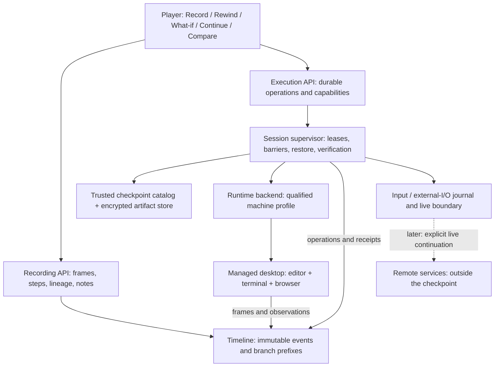

# Executable desktop: system map

**Design proposal, 2026-10-19. These runtime capabilities are not implemented.**
Baseline reviewed: `fcd44bcf522091a9252ccdd66e5bd6391bf7f50b` on `main`.
Start here for the map, then read the [technical design](technical-design.md)
and [implementation gates](implementation-plan.md). Machine-readable draft
contracts live in [contracts/](contracts/).

## The product we are building

Melange should let someone record work in ordinary software, rewind it,
change what they do, and continue in a separate future. The same small player
should work across applications. A watchable recording is useful even when
its execution environment is unavailable.

The first complete slice is an unmodified editor, terminal and browser inside
one managed Linux desktop. The user changes Melange itself, runs real tests,
and sees a real browser preview. No replacement calculator or synthetic
application model stands in for the software.

**Record work → Rewind → Try it differently → Continue → Compare Original.**

The player retains its dark brass/cyan design. Add Record work, Save this
moment, Stop recording and Continue working; keep environment details out
of the normal flow. Rewinding the video does not pause the actual desktop.

## What the codec contains

| Video idea | Computation equivalent | Required evidence |
|---|---|---|
| Keyframe | One consistent machine checkpoint: RAM, devices, every writable disk, configuration, input/I/O cursors | A fresh runtime restores that state |
| Deltas | Ordered inputs and recorded nondeterministic events | Replay reaches a checked state without unexpected live effects |
| Decoder | Versioned runtime backend plus its compatibility profile | The host qualifies that profile before execution |
| Seeking | Restore a checkpoint, then verified replay to a target | Target identity and divergence checks, not elapsed wall time |
| Editing | Fork the prefix and supply different future inputs | Child actually executes; Original remains unchanged |
| Export | Portable recording bundle and ordinary video | Offline playback always distinguished from executable restore |

An executable codec needs more than pixels and mouse coordinates. A captured
accessibility tree does not restore a process. A local VM snapshot does not
rewind a remote database. A generic desktop boundary can preserve opaque
applications without understanding their business logic; semantic edits
such as clicking a number to change its cause remain an additional capability.

## System map

The supervisor is the execution authority. Imported events and a valid ledger
hash cannot grant execution permission. The player asks which actions are
available at the selected moment; it does not infer them from a fidelity label.

## Three capabilities, three proofs

| Capability | Current foundation | Next proof |
|---|---|---|
| Watch and inspect | Terminal/grid recording, structure capture, timeline, dark player | Managed desktop framebuffer capture integrated with the same player |
| Restore and continue | Workspace resume primitives and narrow VM experiments | Whole-machine consistency, isolated child, actual forward execution |
| Edit a responsible input | Native computation/provenance paths in supported recordings | Optional semantic adapters or program analysis for opaque applications |

Keep the existing `native`, `structure`, and `screen-only` capture labels.
Add an independent, supervisor-derived execution descriptor. A desktop may
be screen-only **and** have a restorable machine checkpoint. A rich imported
structure recording may still have no executable environment.

## Decisions for the first milestone

1. **One managed Linux desktop; manual continuation first.** No app patching.
   A small guest helper handles capture barriers and evidence, not an emulator
   of application behavior. Hermes can later consume the same bounded input API.
2. **Exact checkpoints first.** Only a selected frame explicitly bound to a
   verified checkpoint can offer continuation. Other frames offer Go to saved
   moment. Never silently substitute a nearby checkpoint.
3. **Offline first.** Dependencies and browser assets are preinstalled. No
   shared writable host mounts, live NIC, GPU passthrough or outside credentials
   in the initial profile. This makes the execution boundary measurable.
4. **Original stopped before What-if.** Stop means flush recording and pause
   the VM, retaining the final disk state. It does not mean killing the guest
   and discarding unsaved work. Keep Original frozen during isolation checks.
5. **QEMU is the desktop candidate, subject to qualification.** Prove display,
   input, snapshot consistency, private clones and restore before building UI
   promises. Retain Firecracker for its existing headless experiments.
6. **One contract, several backends later.** A backend implements lifecycle and
   checkpoint operations. It cannot bypass the supervisor's artifact, ancestry,
   input or isolation checks.

QEMU documents whole-machine record/replay, including logged inputs and
snapshot-assisted seeking. Its requirements and device coverage must be tested
with our desktop profile. It does **not** establish that Melange can already
turn any replay position into an independent live future. That is a separate
qualification gate. [QEMU replay documentation](https://www.qemu.org/docs/master/system/replay.html)

## What counts as finished

In one continuous demonstration, a user records a real repository workflow,
saves a moment with an unsaved buffer and running processes, then makes later
changes. They stop, select the saved moment, create a What-if and see the old
buffer, old files and old process state restored. They edit code, save it,
run tests and update the browser. The child contains real output; the Original
and published checkpoint retain their hashes. Restarting the service keeps
both versions accessible.

Repeat checkpoint → restore → continue using a second unmodified application
(a text editor or drawing app) through the same backend. Its actual document
and unsaved state must survive; adding a synthetic adapter does not count.

An unchanged, controlled continuation must reproduce the specified files and
test outcomes. This is a workload equivalence test, not a claim that every
instruction or every framebuffer pixel is deterministic.

## Path to the universal codec

```mermaid
flowchart LR
  C0["C0: qualify desktop snapshots"] --> C1["C1: durable lifecycle and artifacts"]
  C1 --> C2["C2: real desktop in the player"]
  C2 --> C3["C3: second app + unchanged continuation"]
  C3 --> C4["C4: verified seek between checkpoints"]
  C4 --> C5["C5: external I/O and live divergence"]
  C5 --> C6["C6: portable bundles + another OS"]
  C6 --> C7["C7: semantic cause editing"]
```

C0–C3 form the next release milestone. C4–C7 expand reach without changing the
normal user workflow. A later profile may support different architecture,
OS or acceleration; portability means explicit compatibility and available
dependencies, not the ability to boot arbitrary RAM images on any machine.

No dates are committed before C0 measures checkpoint size, pause duration,
restore time and interactive latency. The [implementation plan](implementation-plan.md)
defines the next PR and the evidence each gate must produce.
